# Research assistant

A research assistant that runs on your own computer. You ask a question, and it searches Wikipedia, scientific papers, military doctrine, defence and general news, Reddit, LinkedIn, the web and your own documents to answer it. Every statement in an answer is numbered with the source it comes from, so you can check it.

The language models run locally through [Ollama](https://ollama.com): your questions don't go to a cloud AI service, and you don't need an account.

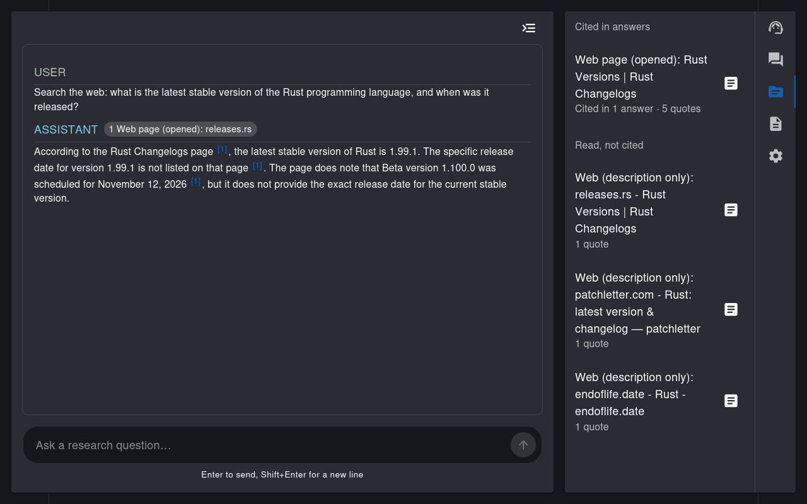

*A real answer: the web search agent found the release in three search results, and the answer is numbered with each of them. The side menu lists what was cited, and what was read but not used.*

## Contents

- [How it works](#how-it-works)
- [The agents](#the-agents)
- [What you need](#what-you-need)
- [Getting started](#getting-started)
- [Keys](#keys)
- [Run it in Docker for your network](#run-it-in-docker-for-your-network)
- [Your documents](#your-documents)
- [Your data](#your-data)
- [Check what you find](#check-what-you-find)
- [Save a conversation](#save-a-conversation)
- [Skills](#skills)
- [MCP servers](#mcp-servers)
- [Troubleshooting](#troubleshooting)
- [Updating](#updating)

## How it works

- **The mediator** is the main model. It reads your question, plans what it needs, and calls one agent at a time until it can answer. If a search finds little, it is told to try other words or another agent before giving up.
- **Agents** each know one kind of source. Most search it and then let a model read what they found, so the mediator gets an answer with its sources instead of a pile of results. Some search agents can open a promising page themselves.
- **Sources are numbered.** Every source an agent used gets an id, and the answer puts its number after each statement, like [1]. The code then checks each statement against the text of its source, and shows a warning when something doesn't add up.
- **Saving:** the download button next to Send saves the conversation and its sources, or a report in the style of a scientific paper with free photos, as PDF or Markdown. See [Save a conversation](#save-a-conversation).
- **The research server** runs alongside the page. It passes model requests on to Ollama, runs the searches that a browser can't do itself, and opens web pages safely as plain text.

The side menu, behind the button at the top right of the chat, has eight tabs:
- **Conversations:** start a new conversation, switch to an earlier one, or delete one or all of them. Each conversation has its own sources.
- **Agents:** turn agents on or off, enter keys, and pick a model and temperature for each agent. Until you pick one, an agent uses the general model and temperature.
- **Agent Conversations** ("Steps" on a phone): see what each agent searched, read and answered.
- **Sources:** every source used in this session, with the passages it was cited for.
- **Documents:** upload your own files.
- **Skills:** instructions for a kind of task, which the model follows. See [Skills](#skills).
- **MCP servers:** extra tools from MCP servers. See [MCP servers](#mcp-servers).
- **Settings:** the theme, from light and dark to Solarized, Nord, Dracula and Gruvbox, and the general model and temperature. The model list shows the models installed in Ollama, and a meter shows how much room skills and MCP tools take.

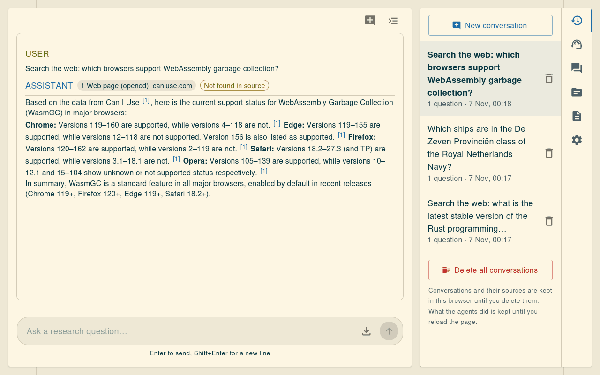

*The Conversations tab. Each conversation keeps its own answers and sources, and the button next to the menu button starts a new one.*

Conversations and their sources are kept in your browser, so they're still there after a reload, until you delete them. What the agents did along the way is only kept until you reload, because it is too much to store. A conversation you open after a reload still knows its earlier questions and answers, so you can ask follow-up questions.

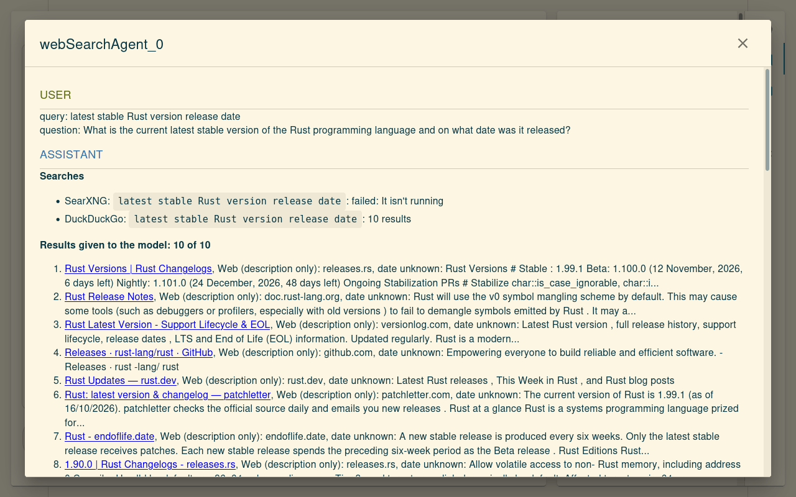

*Agent Conversations shows everything an agent did. Here, the web search agent's searches and the results it read. SearXNG wasn't running, so DuckDuckGo did the search on its own.*

On a phone, the menu slides in from the right, and the tabs have labels:

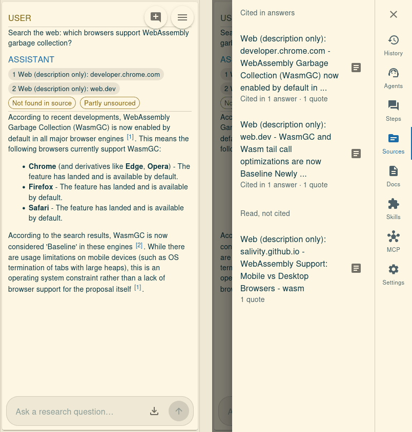

## The agents

| Agent | Searches | Needs |
|---|---|---|
| Wikipedia | Wikipedia articles | A free Wikimedia key |
| arXiv | Scientific papers on arXiv | Nothing; a free OpenAlex key raises the limit |
| Military doctrine | Public doctrine and defence policy | Nothing |
| Defence news | Official statements and the defence press | Nothing |
| News and social | Headlines, discussions and social media | Nothing |
| Reddit | Reddit discussions, through search engines | Nothing |
| LinkedIn | Public LinkedIn posts and events, through search engines | Nothing |
| Web search | The web | Nothing; Docker adds a second search engine |
| Read page | Opens one found page | Nothing |
| Document | Files you uploaded | Uploaded documents |
| Nominatim search and reverse geocoding | Places and coordinates | Nothing |

**Wikipedia agent.** Searches English Wikipedia through the Wikimedia API, picks the pages that fit the question and answers from the relevant sections, including tables and infoboxes. It needs a key, see [Keys](#keys).

**arXiv agent.** Finds papers on arXiv through [OpenAlex](https://openalex.org), picks the most relevant ones and answers from their text. With the embedding model installed it reads the parts of the full paper that match the question; without it, only the abstract. OpenAlex has a daily limit that everyone on your network shares unless you add a key. The settings show how many questions are left today.

**Military doctrine agent.** Searches publicly released doctrine and defence policy documents from GOV.UK, the Dutch government (overheid.nl), the Internet Archive and Crossref, and reads the newest copy it can. It says where each copy comes from, its date and its distribution statement, so you can judge and cite it. Copies labelled as uploaded are public uploads, not official versions.

**Defence news agent.** Looks for recent military and defence news. It keeps official statements (the U.S. Department of War, GOV.UK, the Dutch Ministry of Defence) apart from the defence press (Defense News, Defense One), so each can be weighed differently.

**News and social agent.** Looks for recent leads in news headlines (GDELT), online discussions (Hacker News) and social media posts (Mastodon). It shows what kind of source each lead is, because a post isn't a news report.

**Reddit agent.** Finds Reddit discussions through search engines, because Reddit no longer allows searching without approved access. It only sees short excerpts, not whole threads. It can open outside links that are mentioned in them.

**LinkedIn agent.** Finds public LinkedIn posts, articles and events about innovations and events, through search engines. LinkedIn has no public search and doesn't allow reading its pages, so this only sees what search engines show, which is patchy and often marketing.

**Web search agent.** Searches the web with DuckDuckGo and, when Docker is available, a local [SearXNG](https://docs.searxng.org/) that combines several engines. It sees titles and descriptions, and can open a few of the pages it found.

**Read page agent.** Opens a page that a search found when its description isn't enough, at most 3 per question, and at most twice per search for the search agents. The research server fetches the page and passes on only its text, so nothing on it runs and nothing is downloaded. It refuses addresses on your own network, respects each site's robots rules and doesn't open Reddit or LinkedIn.

**Document agent.** Reads the documents you uploaded in the Documents tab and answers from them, citing the page when it can. It's only available while there are documents.

**Nominatim search and reverse geocoding agents.** Look up places and their coordinates, and the place at a coordinate, in [OpenStreetMap](https://www.openstreetmap.org).

**Ask user and respond.** Always on. The mediator uses them to ask you something back, or to give its answer.

## What you need

- **[Node.js](https://nodejs.org) 22.18 or newer.**
- **[Ollama](https://ollama.com)**, which runs the language models. The two models take about 7 GB of disk space. A graphics card makes answers much faster but isn't required.
- **[Git](https://git-scm.com/downloads)**, to download the code.
- **[Docker](https://docs.docker.com/get-started/get-docker/)** (optional): adds the SearXNG search engine for better web search, and lets you run the assistant for others on your network.

It works on Linux, macOS and Windows. Running it in Docker for your network works on Linux.

## Getting started

### 1. Install Node.js

On Linux and macOS, with [nvm](https://github.com/nvm-sh/nvm):

```sh
curl -o- https://raw.githubusercontent.com/nvm-sh/nvm/v0.40.3/install.sh | bash
# Open a new terminal, then:
nvm install 24
```

On Windows, use the installer from [nodejs.org](https://nodejs.org).

Check it with `node --version`. It should show v22.18 or newer, for example:

```text
v24.13.1
```

### 2. Install Ollama and the models

On Linux:

```sh
curl -fsSL https://ollama.com/install.sh | sh
```

On macOS and Windows, download it from [ollama.com/download](https://ollama.com/download) and start it.

Check it with `ollama --version`. Then download the models, or skip this and let `npm start` ask you later:

```sh
ollama pull qwen3.5
ollama pull nomic-embed-text
```

`qwen3.5` answers the questions. `nomic-embed-text` finds the relevant parts of long papers and documents; without it, the arXiv agent reads only abstracts.

You can use other models too. Install one with `ollama pull <name>`, for example `ollama pull llama3.2`, then pick it in Settings, or for a single agent in its settings. The [Ollama library](https://ollama.com/library) lists the models. Larger models answer better, but need more memory and are slower.

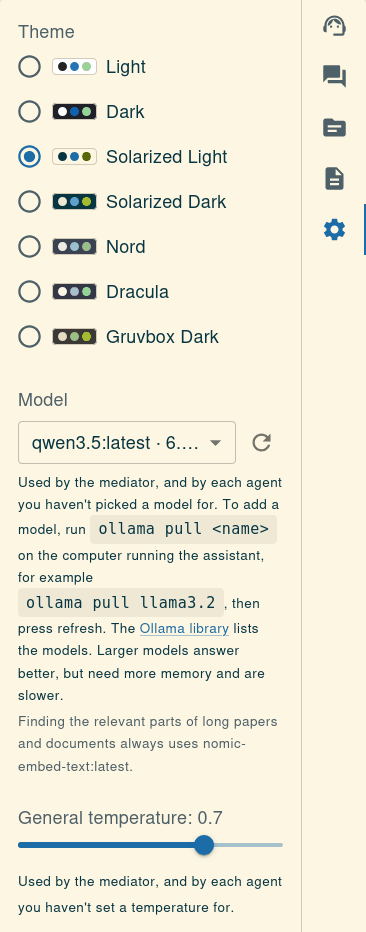

*Settings lists the models installed in Ollama. The refresh button picks up a model you just installed.*

### 3. Install Docker (optional)

On Linux:

```sh
curl -fsSL https://get.docker.com | sh
sudo usermod -aG docker $USER
```

Then log out and back in, so you can use Docker without `sudo`.

On macOS and Windows, install [Docker Desktop](https://docs.docker.com/desktop/) and start it.

### 4. Download the code

```sh
git clone <the address of this repository>
cd research-assistant
```

### 5. Start it

```sh
npm start
```

You should see something like this, and your browser opens the assistant:

```text
[start] Ollama is already running, and will be left running
Research server listening on http://127.0.0.1:3001
[start] Ready at http://127.0.0.1:3001. Press Ctrl+C to stop.
```

This installs what is missing, builds the application, starts it and opens your browser at http://localhost:3001. If a model is missing, you're asked before it's downloaded. If Docker is available, the first start also downloads SearXNG.

Press Ctrl+C to stop it, along with anything it started.

Options:

| Command | What it does |
|---|---|
| `npm start -- --no-open` | Doesn't open a browser |
| `npm start -- --no-searxng` | Doesn't start SearXNG, so web search uses DuckDuckGo alone |
| `PORT=3002 npm start` | Uses another port |
| `npm run start:dev` | Reloads the page while you change the code |

### 6. Optional: add keys

The Wikipedia agent stays off until it has a key. See [Keys](#keys).

## Keys

Most agents need no key. These two can use one:

| Agent | Key | Where to get it |
|---|---|---|
| Wikipedia | Client ID and client secret, required | [Register an OAuth 2.0 app](https://meta.wikimedia.org/wiki/Special:OAuthConsumerRegistration/propose/oauth2) with a Wikimedia account. Choose the "Client credentials" grant. It's free. |
| arXiv | OpenAlex API key, optional | [openalex.org/settings/api](https://openalex.org/settings/api). It's free and raises the daily limit of searches. |

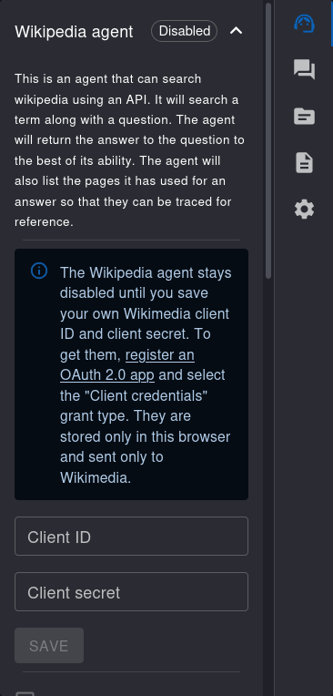

You can enter them in two ways:

- **In the browser:** open the side menu, then the Agents tab, then the agent. The key is stored only in that browser, and sent only to Wikimedia or OpenAlex.
- **For everyone using your computer:** put them in a `.env` file in the project folder. Everyone who uses the assistant on your computer, also from other devices, then uses your keys, and they come before keys entered in a browser.

  ```sh
  cp .env.example .env
  # Fill in the keys in .env, then restart the assistant.
  ```

  The keys stay on your computer: browsers only get short-lived Wikipedia tokens, and OpenAlex searches are relayed through the research server. Everyone shares their limits, so leave them out where people should use their own keys, such as at work.

`.env` is in `.gitignore`, so it isn't uploaded when you push the code. Never share it.

## Run it in Docker for your network

This runs the assistant in Docker on Linux, so others on your local network can use it whenever your computer is on. Ollama keeps running on your computer itself.

1. Install Docker and Ollama, as above.
2. Start it, in the project folder:

   ```sh
   docker compose up -d --build
   ```

   It starts again by itself after a restart of your computer.
3. If your firewall is on, allow your network to reach it. For example, with ufw, for a network that uses addresses starting with 192.168.1:

   ```sh
   sudo ufw allow from 192.168.1.0/24 to any port 3001 proto tcp
   ```
4. Find your computer's address with `ip -4 addr`. Others then open `http://<that address>:3001`.

Everyday commands, in the project folder:

| Command | What it does |
|---|---|
| `docker compose restart` | Restarts it |
| `docker compose up -d --build` | Rebuilds and restarts it after the code or `.env` changed |
| `docker compose down` | Stops it until you start it again |
| `docker compose ps` | Shows whether it's running |
| `docker compose logs -f app` | Shows its messages |

Both this and `npm start` use port 3001. While the Docker version runs, `npm start` only opens your browser on it and starts nothing. Stop the Docker version first to use `npm start`.

Things to know:

- **What others can do:** model requests from other devices go through the assistant's server to your Ollama, which only allows using models, not downloading, changing or deleting them.
- **No login:** anyone on your network can use the assistant and your model.
- **Not encrypted:** the connection is plain HTTP.
- **Separate browsers:** conversations, documents, keys and settings stay in each person's own browser.
- **One internet connection:** all searches and opened pages come from your connection. Search engines block sooner with several users, and web, Reddit and LinkedIn search go beyond the personal use those services allow.

## Your documents

The Documents tab takes Word (`.docx`), PDF, text and Markdown files, so the model can answer questions about them and reason about them.

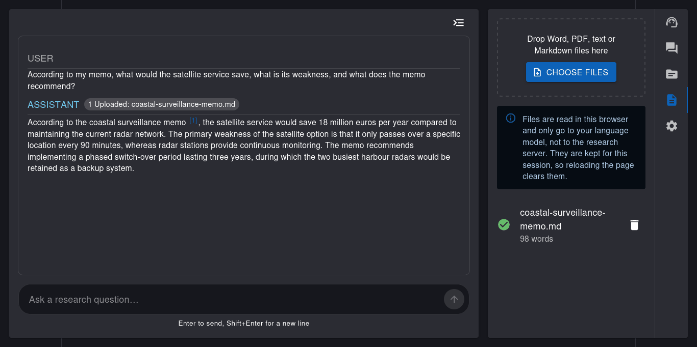

*An example memo uploaded in the Documents tab, and an answer that cites it.*

- **Where they go:** files are read in your browser, and their text only goes to your language model, not to the research server.
- **How long they stay:** for the session, so reloading the page clears them. Conversations about them are kept, but to ask more about a document after a reload, upload it again.
- **What can't be read:** scanned PDFs without text, old `.doc` files, and images.
- **Long documents** are read in part: the start, and what fits the question best.

## Your data

- **Questions** go to your own Ollama.
- **Searches** go to the sources themselves, directly from your browser or through the research server.
- **Photo searches** for a report go to Wikimedia Commons, only when you save a report with photos on.
- **Keys** you enter in the agent settings are stored only in your browser.
- **Skills and MCP servers you add** are stored only in your browser. A key for an MCP server passes through the research server for each request, and is never stored or logged there.
- **MCP tools** you switch on send what the model gives them to that server.
- **Conversations** and their sources are stored only in your browser, until you delete them in the Conversations tab. Someone else using the same browser can see them.
- **Pages** that are opened see a visit from your internet address.

Web search, Reddit and LinkedIn read the result pages of search engines automatically, and some news sources only allow personal use. The research server only does this when it runs on your own computer, or when `PERSONAL_USE_FEEDS=true` is set, as the Docker setup does. Set `PERSONAL_USE_FEEDS=false` to turn them off, and read each source's terms before hosting this for others.

## Check what you find

Every source an agent used gets a number, and the answer puts that number after each statement that comes from it, like [1]. Hover a number to see the passage it is based on, or click or tap it to open the source. The same numbers are on the source labels above the answer.

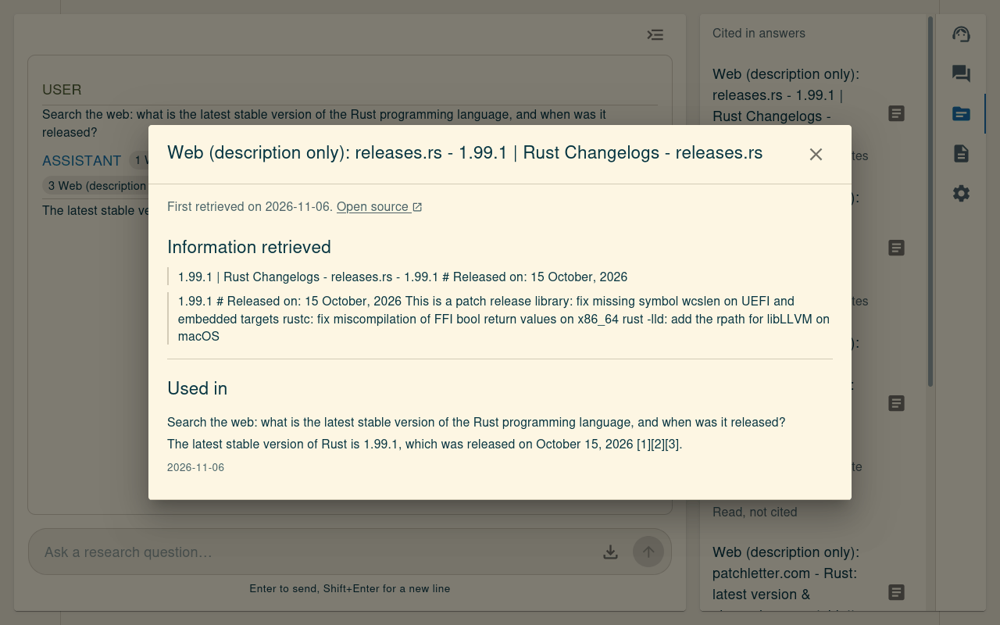

*Clicking [1] shows what was taken from the source and where it was used, with a link to the source itself.*

The code checks each cited statement against the text of its source, and shows a warning when:
- **Not found in source:** a statement can't be found in the source it cites.
- **Partly unsourced:** some statements have no source, so they may be the model's own reasoning or knowledge.
- **Unknown source removed:** the model cited a source that wasn't read.
- **Names an unused source:** the answer names a source, like Wikipedia, that wasn't used.
- **No verified source:** nothing in the answer could be traced back to a source.

When a model didn't quote a source exactly, the passages are matched to its answer automatically, and the source says so.

This shows where a statement came from, not that it is right. Read the passages before relying on an answer.

## Save a conversation

The download button next to Send saves the conversation, once it has an answer. It asks what you want to save, and as what:

- **Conversation and sources:** every question and answer, with their warnings, followed by every source that was cited and the passages taken from it.
- **Report:** a short report in the style of a scientific paper, written in full paragraphs: an abstract, 1. Introduction, 2. Method, 3. Findings in a few subsections, 4. Discussion, 5. Conclusion, the references, and the questions asked.
  - **Who writes it:** your general model writes the text, which takes a moment.
  - **What the code writes:** the Method section, which says how many questions were asked, which model answered and which kinds of sources were cited, and the references. They come from the conversation itself, never from the model, so they can't be made up.
  - **Its sources:** statements cite their source by number, like [1], and the code checks every number. A number of a source that wasn't used is removed, and a paragraph in the findings or the conclusion without any source is marked *(no source)*.
  - **Photos:** with *Add photos from Wikimedia Commons* on, the model suggests what a photo could show, and the assistant looks for it on [Wikimedia Commons](https://commons.wikimedia.org), which only has freely licensed and public domain files. A photo is only used when the model, reading its title and description, says it shows the subject, so some reports get none. Each photo is credited with its author and licence, and links to its page. The search words go to Wikimedia.

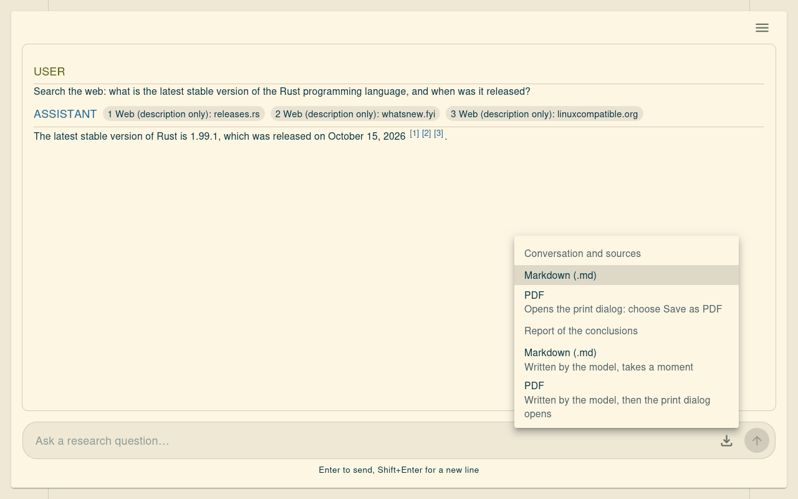

Choose **PDF** for a document to read, print or share, or **Markdown** for plain text to edit or paste into notes. Both are saved in your downloads, on a phone too. A PDF has its photos inside, so it can be read offline; a Markdown file links to them.

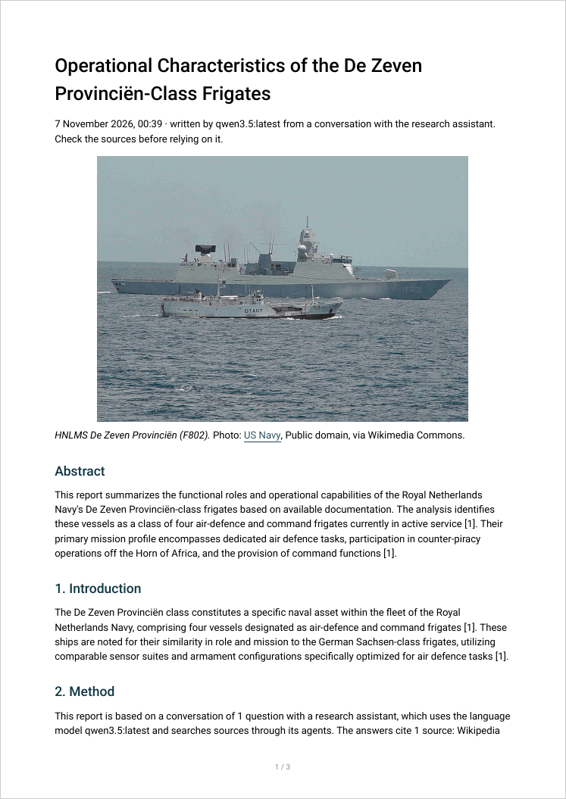

*The first page of a real report. The photo of the frigate came from Wikimedia Commons, with its credit underneath. Which photos are found differs from one report to the next, and some reports get none.*

Each answer numbers its sources from [1], so a saved document numbers them again, once for the whole conversation.

## Skills

A skill is a folder with a `SKILL.md` file: a name, a description of when to use it, and instructions. It's the same format other AI tools use, so existing skills usually work.

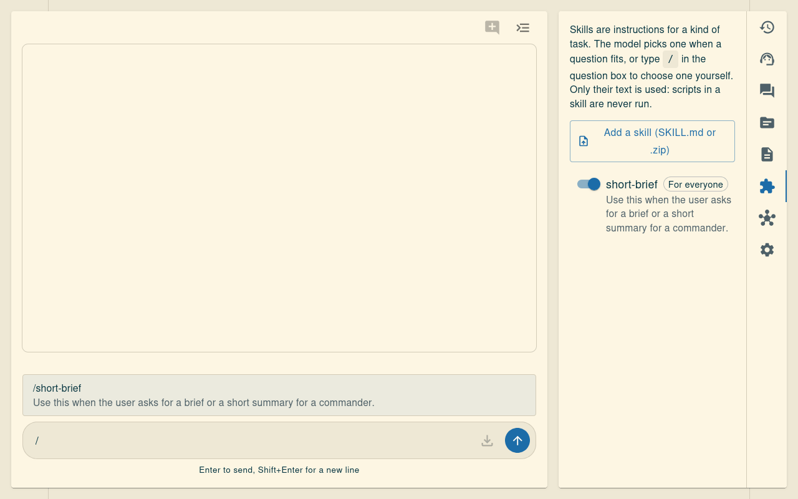

*The Skills tab. Typing / in the question box lists the skills.*

- **The model picks one** when a question fits its description, and reads its instructions then.
- **You can choose one yourself:** type `/` in the question box and pick it. It then applies to that one question.
- **Only text is used.** Instructions and text files are read, and scripts in a skill are never run. The window shows what was left out.
- **The rules on sources always stay in force,** whatever a skill says.

Add skills in three ways:

- **Search for them:** the search box in the Skills tab looks through [skills.sh](https://skills.sh) and [Awesome Skills](https://github.com/sickn33/antigravity-awesome-skills). See [Finding skills](#finding-skills).
- **For yourself:** the Skills tab takes a `SKILL.md` or a `.zip`. You see the full text first, and it's kept in that browser. A skill is instructions to your model, so read skills from people you don't know.
- **For everyone using your computer:** put a folder per skill in the `skills` folder:

  ```text
  skills/
    short-brief/
      SKILL.md
  ```

  ```markdown
  ---
  name: short-brief
  description: Use this when the user asks for a brief or a short summary for a commander.
  ---
  Write the answer in exactly two parts, starting with "BOTTOM LINE:" and "DETAILS:".
  ```

  Reload the page to see a new skill. The name can have lowercase letters, numbers and dashes.

### Finding skills

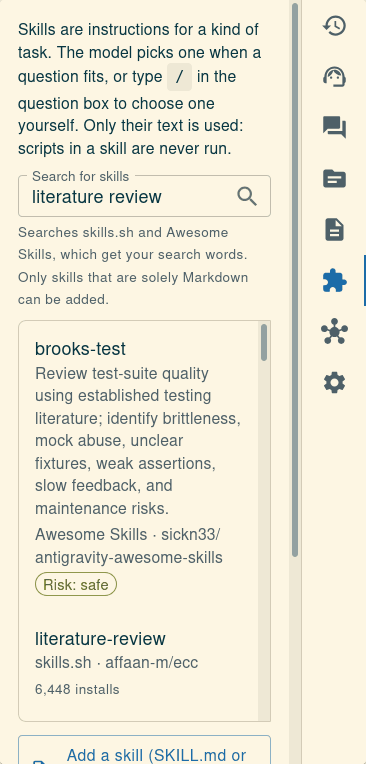

Type what you're looking for and press Enter. Open a result to read it, then choose **Add skill**.

- **Solely Markdown:** a skill can only be added if its whole folder is `.md` files, apart from a licence. If it has anything else, such as a script, an image or a settings file, it's refused and the files are named. Many skills have one of these, so expect some refusals.
- **You read it first.** Anyone can publish a skill, and many installs doesn't mean a skill is safe. Awesome Skills gives each skill a risk label, which is shown, and skills labelled offensive aren't listed. skills.sh has no labels.
- **It's a copy,** kept in that browser. It doesn't change when the original does.
- **What's shared:** your search words go to those sites, through the research server, and only when you search.
- **GitHub's limit:** opening a result uses a lookup, and GitHub allows 60 an hour per internet connection. If you reach that, wait, or put a `GITHUB_TOKEN` in `.env`. A token without any permissions is enough.

skills.sh's search isn't documented for outside use, so it could stop working. Awesome Skills would still be searched.

Skills work with every model, because they're only text. How well they're followed differs per model: small models may miss a fitting skill, so choose it with `/` if that happens.

## MCP servers

[MCP](https://modelcontextprotocol.io) is a standard way to give AI assistants extra tools. The MCP servers tab lists every tool, and every tool starts switched off.

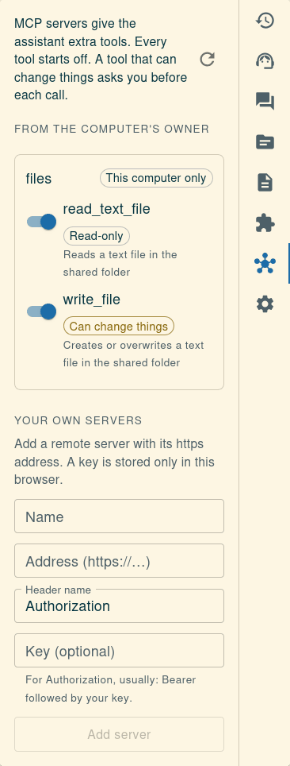

Once switched on, the model can use a tool like any agent, and what it returns becomes a numbered source:

- **Tools labelled read-only** run by themselves. That label is the server's own claim, so only switch on tools from servers you trust.
- **All other tools ask first,** showing exactly what would be sent. You can tick *Auto-confirm this tool in this conversation* if the asking gets annoying. It ends when you switch conversation or reload.

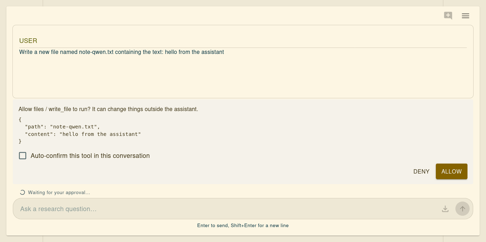

*Read what a tool wants to send. Smaller models can get the values wrong.*

**Search for a server** with the search box in the MCP servers tab, which looks in the official [MCP Registry](https://registry.modelcontextprotocol.io). Open a result to see where it comes from and exactly which address it connects to.

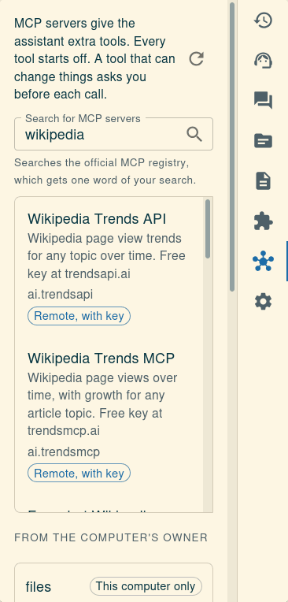

- **Remote** servers can be added directly, and you enter a key if one is needed. They're kept in that browser.
- **Local programs** can't be added from a browser. Opening one gives the text the computer's owner can paste into `config/mcp.json`.
- **Being listed doesn't mean a server is safe.** Anyone can publish to the registry, and what a tool is given goes to that server. The same protections apply as for any server.
- **What's shared:** the registry gets one word of your search, because it only looks in server names. Searching for one word from a name, like "arxiv", works best.
- Some servers can't be added yet: those that only allow an OAuth sign-in, use the older SSE connection, or need more than one key.

**Servers that need a key:** a key is one header, usually `Authorization`, stored in that browser and sent through the research server with each request. Paste just the key; `Bearer` is added for `Authorization`. Not every server says beforehand that it needs one, so you can also add or change a key later with **Add key** or **Change key** on your own server. If a tool can't run without a key, a warning above the question box says so, with the server's own explanation.

**Check that a server works** with **Test** on its card, which shows whether it responds, how fast, and how many tools it offers, or what's wrong. Passing doesn't prove a key is right, because many servers only check a key when a tool runs. To be sure, use **Try** on a tool: fill in the values, run it, and read the result. Nothing goes to the model, and the tool doesn't have to be switched on. A tool that can change things really does so, and warns you first.

**Add your own remote server** by hand in the MCP servers tab, with its `https` address and, if it needs one, a key. The key stays in that browser, like the Wikipedia keys. Addresses on your own network are refused here, and servers that only allow an OAuth sign-in in a browser window can't be added yet.

**For everyone using your computer,** copy the example and list your servers. Local programs can only be started from this file, never from a browser:

```sh
cp config/mcp.example.json config/mcp.json
```

```json
{
  "mcpServers": {
    "files": {
      "command": "npx",
      "args": ["-y", "@modelcontextprotocol/server-filesystem", "/path/to/a/folder"]
    },
    "my-remote-server": {
      "url": "https://example.com/mcp",
      "headers": { "Authorization": "Bearer ${MY_SERVER_KEY}" },
      "shared": true
    }
  }
}
```

- **Secrets:** write them as `${NAME}`, and put `NAME=…` in `.env`. `config/mcp.json` is in `.gitignore`.
- **Who can use it:** a server only works from the computer itself, unless it has `"shared": true`. There's no login, so anyone on your network can use a shared server, including tools that change things. Don't share a server with access to anything private.
- **Other names for your computer:** if you open the assistant by a name with dots that isn't `.local`, `.lan`, `.home` or `.internal`, list it in `MCP_ALLOWED_HOSTS` in `.env`.
- **Changes** take effect after a restart: Ctrl+C and `npm start`, or `docker compose restart`.
- **In Docker,** programs started with `npx` work. Others, like Python servers, can run separately and connect with `"url": "http://127.0.0.1:…"`.

Each tool you switch on takes up room in every request, and local models have little of it. Settings shows how much is used, and warns when it's a lot.

## Troubleshooting

**"Ollama can't be reached".** Start Ollama: open the Ollama app, or run `ollama serve`. On Linux it usually runs as a service: `systemctl status ollama`.

**Answers are slow.** The models run on your own computer, so speed depends on it. A graphics card helps a lot. The first question after a start is slower, while the model loads.

**Web search finds little.** DuckDuckGo sometimes blocks automated searches, and the assistant then waits 15 minutes before trying it again. With Docker installed, SearXNG keeps working meanwhile.

**"Port 3001 is in use".** Something else uses that port, maybe the Docker version. Stop it, or use another port: `PORT=3002 npm start`.

**"Permission denied" from Docker.** Run `sudo usermod -aG docker $USER` and log out and in again.

**The Docker version shows an old version.** Rebuild it: `docker compose up -d --build`.

**The Wikipedia agent can't be turned on.** It needs a key, see [Keys](#keys).

## Updating

```sh
git pull
npm start
```

`npm start` installs and rebuilds what changed. For the Docker version, run `docker compose up -d --build` after `git pull`.
